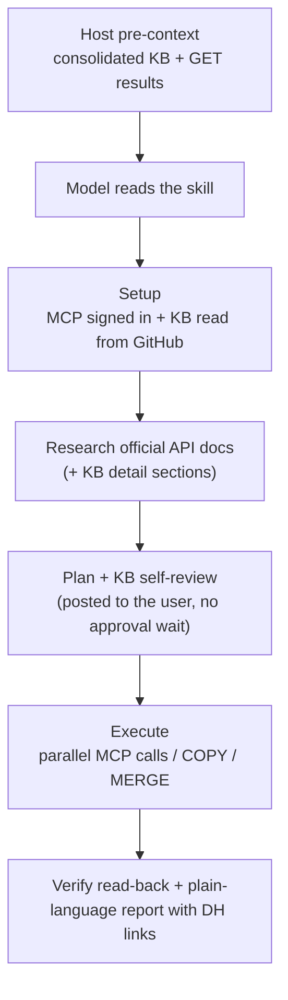

# viaSocket Developer Hub — Skill Architecture

How the skills in `skills/` work and how to run them. Every Developer Hub call goes through the DocStar MCP
`https://mcp.docstar.io/connector/viasocket_developer_hub` — no shell, no downloaded script, no token in the prompt.


## 1. Prompt templates

Fill the placeholders and send to the model. The host loads the pre-context (§2) before the skill runs.

### 1.1 Plug — `SKILL-PLUG-CREATION.md`

Create or extend a whole plug: branding, connection, reusable components, every action and trigger.

```text
Build Plug Integrations in viaSocket Read https://raw.githubusercontent.com/RoystonSanctis/dh-planner-viasocket/refs/heads/dev/skills/SKILL-PLUG-CREATION.md and follow it.

Input:
ORG_ID: <YOUR_ORG_ID>
APP_NAME: <APP_NAME>
APP_DOMAIN: <APP_DOMAIN>
API_BASE: <API_BASE_URL>
USECASE: <DESCRIPTION_OF_INTEGRATION_GOALS>
```

* `ORG_ID` — viaSocket organization ID (e.g. `org_abc123`).
* `APP_NAME` / `APP_DOMAIN` — app name and primary domain (e.g. `Slack` / `slack.com`).
* `API_BASE` — Developer Hub API base URL (production, testing or local).
* Auth — connect and sign in to the MCP first; the MCP adds the user's token to every call.
* `USECASE` — optional scope (e.g. "CRUD actions for Contacts, webhook trigger for new deals"). Empty → every action and trigger.

### 1.2 Connection — `SKILL-CONNECTION.md`

Create, edit, or copy into a new version one connection (`oauth_details`) of an existing plug.

```text
Build Plug Connection in viaSocket Read https://raw.githubusercontent.com/RoystonSanctis/dh-planner-viasocket/refs/heads/dev/skills/SKILL-CONNECTION.md and follow it.

Input:
ORG_ID: <YOUR_ORG_ID>
PLUGIN_ID: <PLUGIN_RECORD_ID>
APP_NAME: <APP_NAME>
APP_DOMAIN: <APP_DOMAIN>
PREFERRED_AUTH_ID: <EXISTING_AUTH_ID_OR_EMPTY>
API_BASE: <API_BASE_URL>
REQUEST: <WHAT_AUTH_TO_CONFIGURE>
```

* `PREFERRED_AUTH_ID` — optional connection to change or copy. Empty → the plug's preferred connection.
* `REQUEST` — e.g. "OAuth 2.0 authorization code with scopes read, write" or "add an api_key header".

### 1.3 Action / trigger — `SKILL-ACTION.md`

Create or update one action or trigger of an existing plug (always on a draft version).

```text
Build Plug Action in viaSocket Read https://raw.githubusercontent.com/RoystonSanctis/dh-planner-viasocket/refs/heads/dev/skills/SKILL-ACTION.md and follow it.

Input:
ENTITY_TYPE: <action | trigger>
ORG_ID: <YOUR_ORG_ID>
PLUGIN_ID: <PLUGIN_RECORD_ID>
APP_NAME: <APP_NAME>
APP_DOMAIN: <APP_DOMAIN>
SKILL_MODE: <create | update>
ACTION_ID: <ACTION_ID_IF_UPDATE>
ACTION_NAME: <ACTION_OR_TRIGGER_NAME>
VERSION_ID: <CONFIRMED_DRAFT_VERSION_ID_IF_UPDATE>
PREFERRED_AUTH_ID: <PREFERRED_AUTH_ID>
API_BASE: <API_BASE_URL>
REQUEST: <WHAT_THIS_ACTION_OR_TRIGGER_DOES_OR_CHANGES_REQUESTED>
```

* `SKILL_MODE` — `create` or `update`.
* `ACTION_ID`, `ACTION_NAME`, `VERSION_ID`, `PREFERRED_AUTH_ID` — optional; resolved from the rows
  (action by name/key; latest draft, or a new draft copied from the latest version — never a `published` one).

## 2. Architecture: pre-context + process + tool



1. **KB + pre-context:** the setup reads the consolidated KB from GitHub (`knowledge-base/<file>`); the host pre-loads the GET results the skill
   needs. The skills say "don't re-fetch"; anything missing is read through the MCP.

   | Skill | Consolidated KB | GET results |
   | ----- | --------------- | ----------- |
   | Plug | `dh-knowledgebase.md` + `dh-connection-kb.md` | org's plugs (or search via `getPluginByQuery`); for a plug on the domain: details, connections, connection usage, actions, components |
   | Connection | `dh-connection-kb.md` | plug, connections, connection usage |
   | Action | `dh-knowledgebase.md` | plug, connections, actions, components |

2. **Skill = process + tools; KB = knowledge.** A skill holds only the steps, the Developer Hub REST contract (where
   it overrides the KB payload schemas) and the tool. Design and runtime knowledge (UX, fields, naming, code rules,
   runtime globals and limits, review priorities) lives in `knowledge-base/`; detailed sections are read on demand
   (`<file> "Heading"`).
3. **Research → plan → execute.** Ask all clarifications upfront at the start (missing inputs, unverified API docs or
   curl, auth details); once proceeding with creation, do not ask or interrupt — post a high-level plan and execute
   without an approval pause.
4. **One shared tool.** All skills call Developer Hub through the MCP (`call_any_api_of_viasocket_developer_hub`, or a
   dedicated MCP tool when one fits). What the old script did automatically (code check, provenance, MERGE, COPY,
   connection encoding) is spelled out in each skill's §2 and done by the model.
5. **Parallel single-row calls.** Developer Hub endpoints take one row per call; independent calls of a level go out together.
6. **Metadata on create/update, not publish.** `plugins`/`actions` `metadata.aiLogs` and plug `metadata.aiContext` are
   MERGEd during Execute (every create/update). Publish only flips `status` / version publish fields — never defer
   metadata until the user says yes to publish (or skip it because a skill never publishes).

## 3. Skill comparison

| | Plug | Connection | Action |
| - | ---- | ---------- | ------ |
| **Scope** | whole plug (create or extend) | one connection | one action or trigger |
| **Branching** | domain match → extend, else create | create · edit in place (non-breaking, unused) · `COPY` to a new version (breaking or in use) | create · edit draft · `COPY` latest version to a new draft |
| **Execution** | L0 plug · L1 connection ∥ components ∥ brand details · L2 actions/triggers ∥ plug MERGE · L3 versions ∥ mappings (unmap/delete via PATCH) | write → plug MERGE | components → action → version ∥ mappings (unmap/delete via PATCH) → action MERGE |

## 4. MCP

| Tool | Use |
| --- | --- |
| `search_viasocket_developer_hub_docs` · `get_viasocket_developer_hub_api_docs` | find an endpoint's exact URL, headers, body |
| `call_any_api_of_viasocket_developer_hub` | every read/write: `{ url, method, headers: { "proxy_auth_token": "", "Content-Type": "application/json" }, query, body }` |

URLs: `DH_BASE/<path>` = `<API_BASE>/developers/<ORG_ID>/<path>`; `/<path>` = `<API_BASE>/<path>`. The auth header is
sent empty — the MCP fills in the signed-in user's token. Done by the model on every write (see each skill's §2):

* **Code check** — all code fields, field generators and `authenticationpaths` values parse before the write.
* **Provenance** — `create/*` gets a `metadata.aiLogs` `CREATED_BY_SKILL` entry (+ `metadata.createdBy` on plugs);
  `create/actions` is followed by a MERGE setting `isaiaction` + `aiorgid`.
* **MERGE** — GET the row, keep every metadata key, deep-merge `metadata.aiContext` (+ `updatedAt`), append an
  `UPDATED_BY_SKILL` entry, PUT.
* **COPY** — GET the parent's rows, drop DB-managed keys (`rowid`, `autonumber`, timestamps, creator keys, `metadata`;
  connections also `pluginname`, `pluginiconurl`, `domain`, `isencrypted`, `clientsecret`; versions also `version`,
  `versionid`, `status`, `isdeleted`, `actionversionrecordid`, `publishdescription`), apply changes, add
  `metadata.duplicatedfrom`, POST create. Versions become `drafted`; connections keep `authversion`.
* **Connection encoding** — `testcode`, `accesstokencode`, `refreshtokencode`, `revokeapicode` sent as `{"source": …}`
  strings; a `queryparams` object is stringified.

## 5. Operational rules

1. **Auth** — the MCP sign-in only; never ask for, print or pass a `proxy_auth_token`.
2. **Credentials** — never asked for in chat (client ID/secret, API keys, passwords). The developer enters them in
   Developer Hub; the skill leaves them empty.
3. **Never publish, never hard-delete, never edit a `published` version** — changes go to a `drafted` version or a
   new copy.
4. **Branch / fork** — skills and KB point to `dev` (`RoystonSanctis/dh-planner-viasocket`). For another branch or
   fork, use its skill URL and its `knowledge-base/` raw URL.
5. **Editing the MCP rules** — keep the per-skill §2 and §4 above in sync.
